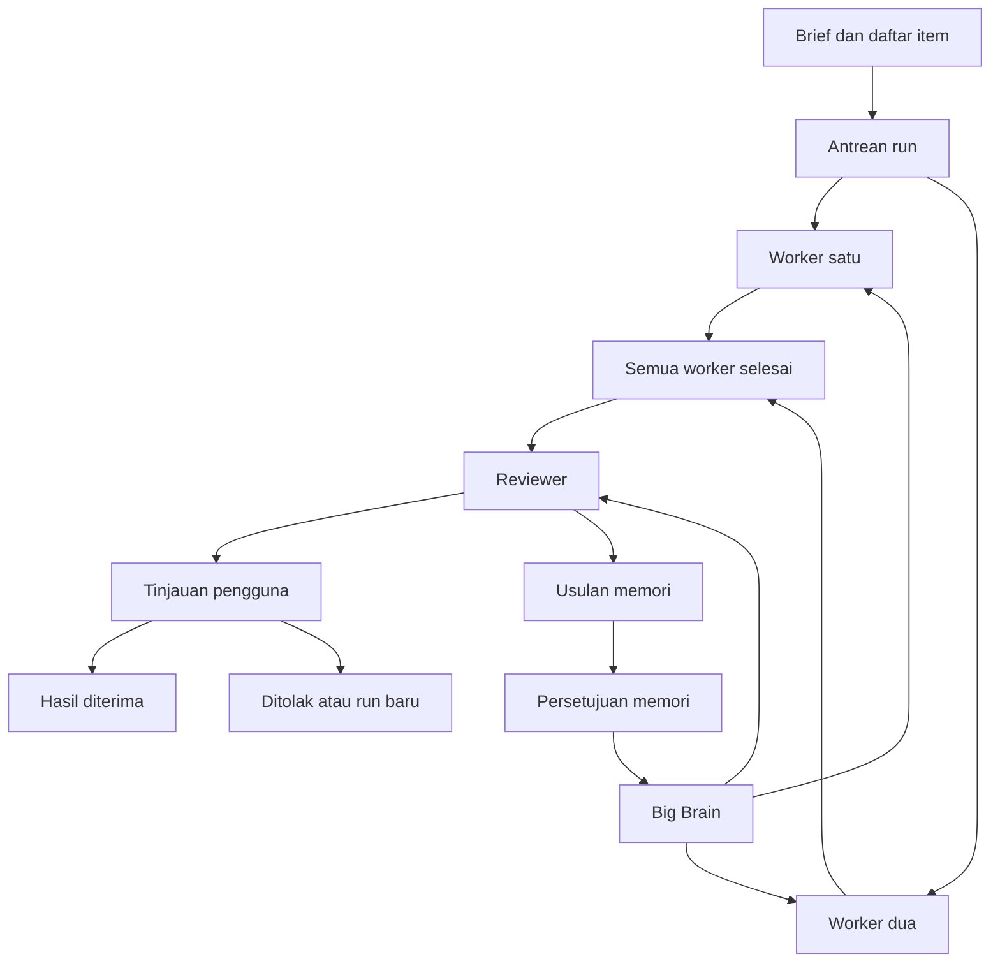

# Arsitektur dan mekanisme

## Komponen

Browser memuat HTML/CSS/ES modules lokal. Renderer membangun geometri 3D otak, meja, karakter, monitor, pot, lantai, dan jalur memori. WebGL memakai depth testing; renderer CPU cadangan memproyeksikan mesh yang sama dengan detail lebih rendah dan painter sorting. Fallback CPU dapat memiliki artefak occlusion pada bidang berpotongan; WebGL adalah jalur utama. Tidak ada CDN atau dependensi JavaScript eksternal.

HTTP API menggunakan standard library Python dan SQLite WAL. UI polling setiap 1,5 detik; importer memori tiap 5 detik. MCP stdio adalah bridge ke API yang sama, sehingga semua penulisan memori dikelola satu service. Ini bukan stream token atau tracing seluruh tool Hermes.

## Orkestrasi

Satu run diproses pada satu waktu untuk membatasi beban laptop. Worker item dalam run berjalan paralel sampai max_parallel. Item dibagi round-robin ke worker; satu profil/agen selalu diserialkan dengan lock. Reviewer berjalan setelah semua worker sukses. Jika worker gagal, reviewer tidak dimulai. Reviewer tambahan berjalan berurutan. Selesainya reviewer selalu masuk awaiting_approval; verdict reviewer tidak mengubah dirinya menjadi approval manusia.

Keadaan run: queued → running → reviewing → awaiting_approval → done. Cabang gagal: failed/cancelled/interrupted. Restart menandai pekerjaan aktif interrupted; tidak ada retry otomatis yang berisiko menggandakan tindakan atau biaya. Retry eksplisit membuat run baru dan mempertahankan hasil lama.

## Big Brain

Dua lapisan penyimpanan:

1. Sumber eksternal read-only: file cache/memori terpilih, path, byte, SHA-256, konten, status, waktu perubahan yang terdeteksi.
2. Notes terkelola: proposal → approved/rejected, judul, isi, sumber, waktu. Hanya approved masuk konteks agen.

Jumlah byte adalah ukuran mentah sumber yang tersedia ditambah byte UTF-8 isi note approved. Tidak memasukkan metadata SQLite, proposal pending/rejected, jumlah token atau penggunaan RAM/VRAM. Duplikasi isi antarfile tidak dideduplikasi secara semantik; setiap file yang didaftarkan adalah sumber tersendiri.

Snapshot diambil ketika setiap task dimulai, sehingga reviewer bisa memperoleh pengetahuan terbaru setelah worker selesai. Default batas 24.000 byte; truncation, ukuran asli, ukuran yang disertakan, waktu, dan SHA-256 dicatat. Truncation mengikuti batas byte tanpa memotong encoding UTF-8. Ini kebijakan urutan sederhana, bukan RAG/ranking semantik. `office_brain` memungkinkan pembacaan terkini dengan pencarian substring. Hasil MCP juga dibatasi agar tidak membanjiri konteks.

Importer tidak menulis MEMORY.md/USER.md, tidak memodifikasi state.db Hermes, tidak mengambil alih provider memory. Pengetahuan bersama baru tetap berada dalam database kantor dan dapat dibaca semua agen lewat MCP/snapshot. Tidak ada sinkronisasi dua arah otomatis ke cache asli.

## Korelasi dan hasil

Setiap run/task memiliki ID. Folder task menyimpan prompt.txt, console.log, result.json serta artefak yang dibuat agen. Environment proses dan prompt membawa task_id. Gateway yang sudah berjalan tidak selalu mewarisi environment baru, sehingga agent MCP progress menerima task_id sebagai argumen eksplisit.

Progress live adalah laporan agen pada milestone, bukan ukuran penyelesaian yang dihitung dari token. Bila agen tidak melapor, status running tetap terlihat dan persentase dapat bertahan di 0 hingga receipt valid. Animasi adalah representasi status, bukan bukti setiap tool call.

## Batas akses

Server default hanya 127.0.0.1, memeriksa Host/Origin, menolak cross-site, dan memerlukan bearer token lokal untuk API data/mutasi. Endpoint session memberikan token kepada origin UI lokal; ini proteksi web lintas origin, bukan autentikasi multiuser. Semua proses yang berjalan sebagai pengguna OS yang sama tetap dipercaya. Jangan expose port ini ke internet. `--preview` hanya untuk QA demo dan bind 0.0.0.0; jangan dipakai pada instalasi live.

Path static dibatasi ke web/. Tidak ada endpoint untuk menjalankan shell dari browser. Perintah Hermes berasal dari config lokal; prompt dilewatkan sebagai file. Renderer dan log menggunakan textContent untuk konten dinamis. Semua sumber/cache/log lokal tetap sensitif menurut isi pengguna.
